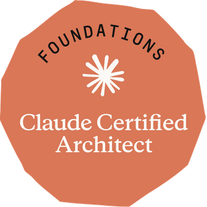

On November 20, 2026, I passed the **Claude Certified Architect – Foundations (CCAR-F)** exam, earning my second Anthropic certification.

Earlier this year, I completed the [Claude Certified Associate – Foundations](/ai/claude-certified-associate-foundations/) certification as my first Anthropic credential. That exam focused primarily on using Claude effectively in a professional environment. The Architect certification goes considerably deeper into how Claude-based systems are designed and integrated.

## What the certification covers

The Architect exam focuses on building and designing production systems around Claude.

That includes areas such as agentic system design, tool use, Model Context Protocol (MCP), context management, workflow orchestration, validation, and human oversight.

Compared with the Associate certification, this exam is much more focused on architecture and on how the different components of an AI system work together.

## How I prepared

I spent significantly more time preparing for this exam than I did for the Associate certification.

My preparation included a Claude Architect training course, reviewing the core architecture concepts, and working through practice exams from several different sources.

I found the practice exams particularly useful because they exposed me to different ways the same concepts could be tested. Most of the better practice exams were similar in style and difficulty to what I eventually saw on the actual exam, although one set was considerably harder than the real test.

Using the first several practice-exam sets as a guide, I was consistently scoring around 85 percent during my preparation. On the actual exam, I scored **837**, which lined up reasonably well with how I had been performing during practice.

Overall, I think working through multiple sets of practice questions was one of the most useful parts of my preparation. It helped reinforce areas such as agent workflows, MCP, tool integration, context management, and the distinction between deterministic workflows and more autonomous agentic systems.

## Who is this certification for?

I think this certification is most useful for architects and technical professionals who want to understand how Claude can be incorporated into larger enterprise solutions.

It goes beyond prompt engineering and model usage and focuses more on the surrounding architecture required to build reliable AI systems.

## What’s next

This was the certification my manager originally asked me to pursue when I began looking at Anthropic's certification program earlier this year.

Completing it closes the loop on that original goal. I expect the concepts covered by the exam, particularly agents, MCP, orchestration, and AI architecture, to continue becoming increasingly relevant in my work.

## Claude Certified Architect – Foundations (CCAR-F)

Issued by Anthropic

Earned November 20, 2026

[View the credential on Credly](https://www.credly.com/badges/9957400a-462c-4cf9-a9e4-7cd7faa8684f)
