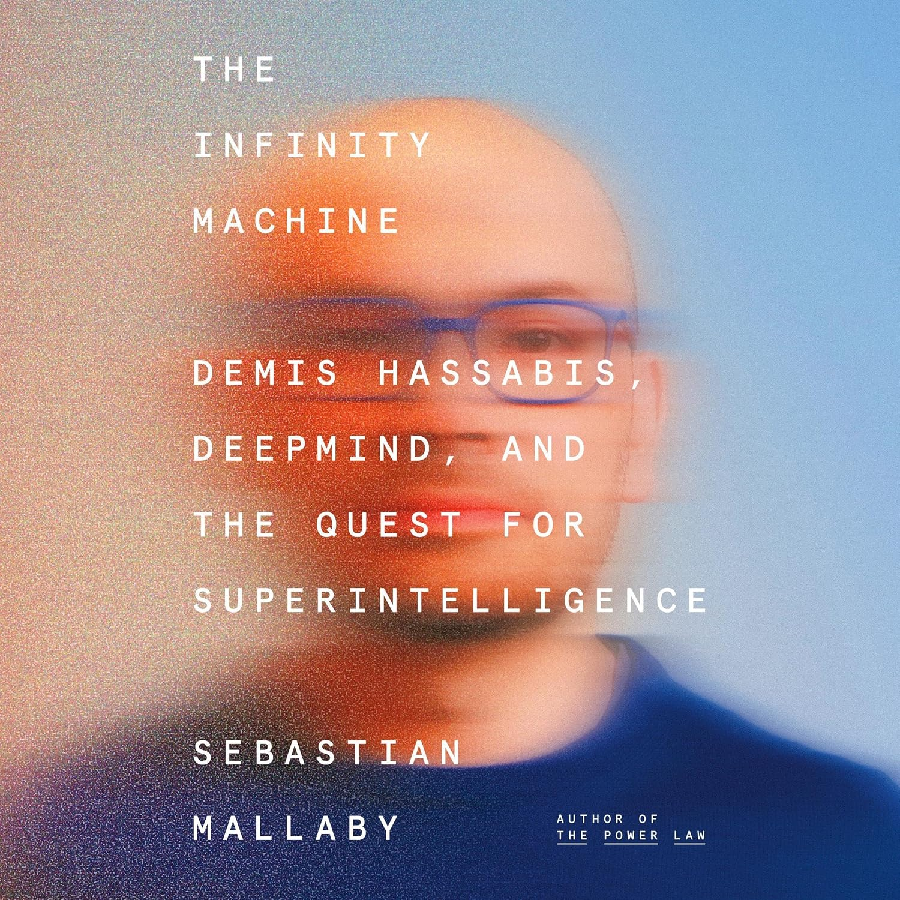

The Infinity Machine by Sebastian Mallaby is a fascinating history of DeepMind and of Demis Hassabis's effort to build Artificial General Intelligence.

I picked up the book after hearing it discussed on The Artificial Intelligence Show shortly after Hassabis stepped down as CEO of Google DeepMind. One of the observations from that discussion was that the move made sense if you understood Hassabis's motivations. He has always seemed more interested in scientific discovery than in running a large corporation, and that comes through clearly throughout the book.

One of the things I found most interesting was how many familiar names kept appearing. As I have read more about AI, listened to more podcasts, and studied the field more seriously, the same people—Hassabis, Mustafa Suleyman, Elon Musk, Sam Altman, and others—continue to surface from different perspectives. The early relationship between Hassabis and Suleyman, for example, added useful context to The Coming Wave, while the interactions with Musk, Altman, Google, and others helped connect several pieces of modern AI history that I had previously encountered separately.

The book also illustrates just how quickly the AI landscape changes. It ends during a particularly strong period for Google and DeepMind, yet AI moves so quickly that the ending already feels somewhat dated.

In the final discussion of computation, Hassabis raises the possibility that classical digital computers may ultimately be capable of discovering many of the important patterns in nature without requiring fundamentally different quantum systems. He leaves open the possibility that some problems may eventually require quantum computing, but his broader bet appears to be that classical computation still has much farther to go.

That question caught my attention because IBM has recently been encouraging me to take additional training in quantum computing. It also raises a much larger question than AI alone: how far can computation ultimately take us in understanding intelligence, biology, physics, and perhaps even reality itself?
